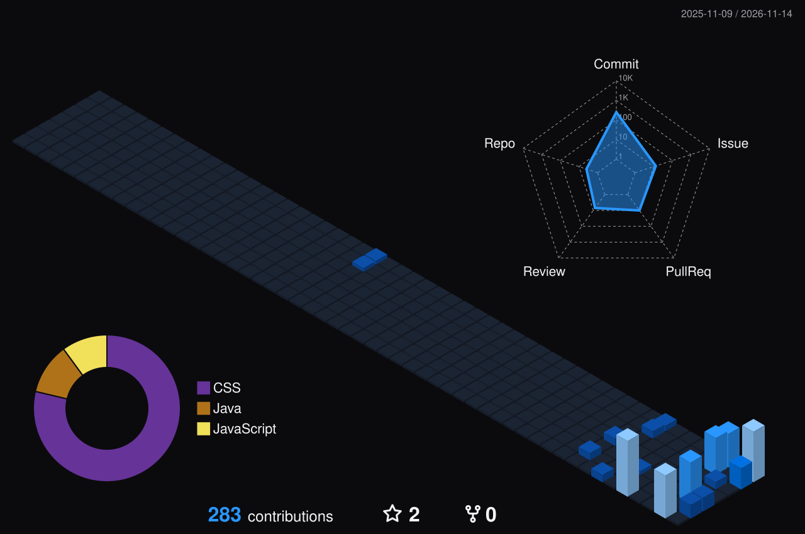

[🇧🇷 Português](./README.md) &nbsp;·&nbsp; 🇺🇸 **English**

 

&nbsp;
&nbsp;
&nbsp;

## About

Software engineer in training (full stack) and **Computer Science** student. I build **Java APIs with Spring Boot**, **responsive React interfaces** and automate tests in **Python**. I am currently a Software Engineering apprentice at **Cielo**, working on automation and software quality.

In the Interest Calculator I use `BigDecimal` instead of `double` and decide where to round: only in the final result, with 2 decimals (HALF_UP). I think about the whole system: how back end and front end connect, how the screen adapts to a phone and what happens when something fails. I use AI as an engineer, not as a shortcut: I define the structure and the rules, then I review and test what it writes.

I am in training and I grow with every project, now on the job too, at Cielo. I learn by building, getting it wrong, fixing it and measuring.

## Projects

<table>
<tr>
<td width="38%" valign="middle">

### [Interest Calculator](https://github.com/AndreGraccia/calc-juros)

Java 25 and Spring Boot API that calculates simple and compound interest with `BigDecimal`. Banco Central indicators are on the roadmap.

`Java` `Spring Boot` `Maven`

</td>
<td width="62%"></td>
</tr>
<tr>
<td valign="middle">

### [wall.ia](https://github.com/AndreGraccia/wall.ia)

Full-stack financial management with Spring Security and JWT.

`React` `Spring Boot` `PostgreSQL` `Docker`

</td>
<td></td>
</tr>
<tr>
<td valign="middle">

### [Orbit.IA](https://github.com/AndreGraccia/Orbit.IA)

Personal agent with a React interface and n8n orchestration, integrated with Google Workspace and GitHub.

`React` `n8n` `LangChain` `Docker`

</td>
<td></td>
</tr>
</table>

## Stack

&nbsp;&nbsp;&nbsp;&nbsp;&nbsp;&nbsp;&nbsp;&nbsp;&nbsp;&nbsp;&nbsp;&nbsp;&nbsp;&nbsp;&nbsp;&nbsp;&nbsp;&nbsp;

## Activity

 

 

## Contact

[LinkedIn](https://www.linkedin.com/in/andregraccia/) · [andregraccia2105@gmail.com](mailto:andregraccia2105@gmail.com) · São Paulo, Brazil

The skyline and activity charts are generated daily by GitHub Actions. The terminal outputs are illustrative.
