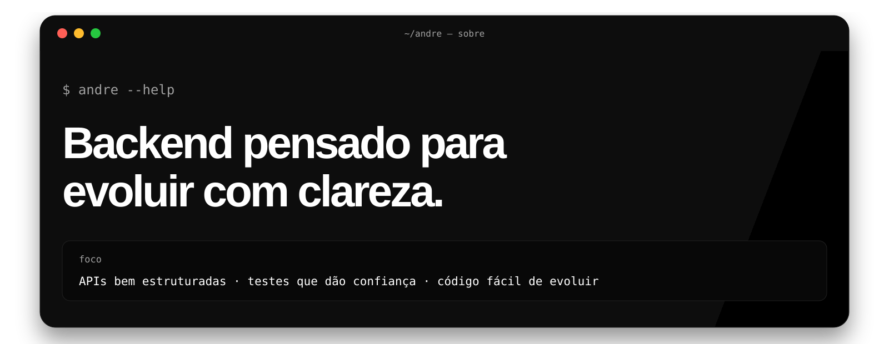
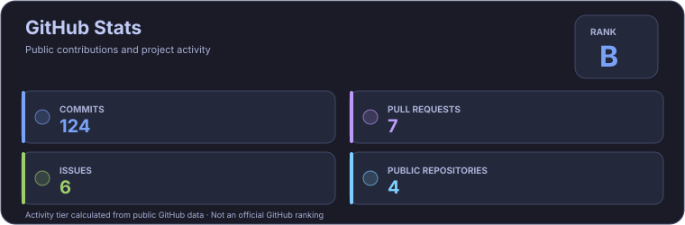

  

  
  
  

 

  

## Sobre mim

Sou estudante de **Ciência da Computação** na Universidade Anhembi Morumbi e atuo na área de **Engenharia de Software na Cielo**. Tenho direcionado meus estudos e projetos para o desenvolvimento de software, com foco em soluções backend, integração entre sistemas e qualidade de código.

Gosto de entender o problema antes de implementar a solução. Por isso, valorizo código legível, responsabilidades bem definidas, testes, documentação e decisões técnicas que facilitem a manutenção e a evolução dos projetos.

| Área | Foco |
| :--- | :--- |
| Principal | Java · Spring Boot · APIs REST · SQL |
| Em desenvolvimento | Python · AWS · IA aplicada · automação |
| Localização | São Paulo, Brasil |

## Tecnologias e ferramentas

  
   
  
  

 

  

## Projetos em destaque

Abaixo estão alguns projetos que representam minha evolução prática em desenvolvimento backend, aplicações full-stack, integração de serviços e automação.

| Projeto | Sobre | Tecnologias |
| :--- | :--- | :--- |
| [**Wall.ia**](https://github.com/AndreGraccia/Wall.ia) | Aplicação full-stack voltada à gestão de carteiras e movimentações financeiras. O projeto explora autenticação, histórico de operações e organização de regras de negócio. | Java · Spring Boot · React · PostgreSQL · Docker |
| [**Calculadora de Juros**](https://github.com/AndreGraccia/calc-juros) | Projeto em desenvolvimento para simular juros simples e compostos e trabalhar com indicadores econômicos, incluindo dados do Banco Central. | Java 25 · Spring Boot · Maven · APIs REST |
| [**Orbit.ia**](https://github.com/AndreGraccia/Orbit.IA) | Agente pessoal de IA com interface própria e workflows de automação. O projeto explora a integração entre frontend, n8n e serviços de IA. | React · Vite · n8n · Docker |

> Os projetos evoluem continuamente. Consulte cada repositório para ver o escopo atual, as funcionalidades implementadas, as decisões técnicas e os próximos passos.

## Destaques profissionais

- **Backend:** desenvolvimento de aplicações e APIs REST com Java e Spring Boot.
- **Integração:** comunicação entre serviços, consumo de APIs e persistência em bancos relacionais.
- **Automação e IA:** construção de workflows com n8n e experimentação com agentes e modelos de IA.
- **Engenharia de software:** organização de código, Git/GitHub, documentação técnica e evolução incremental de projetos.

## GitHub Activity

  

  <a href="https://github.com/AndreGraccia?tab=repositories">Ver todos os repositórios</a> ·
  <a href="https://github.com/AndreGraccia?tab=overview">Ver atividade e contribuições</a> ·
  <a href="https://github.com/AndreGraccia">Abrir perfil no GitHub</a>

## Vamos conversar?

Estou aberto a trocar experiências sobre desenvolvimento de software, projetos, tecnologia e oportunidades na área.

  
  

