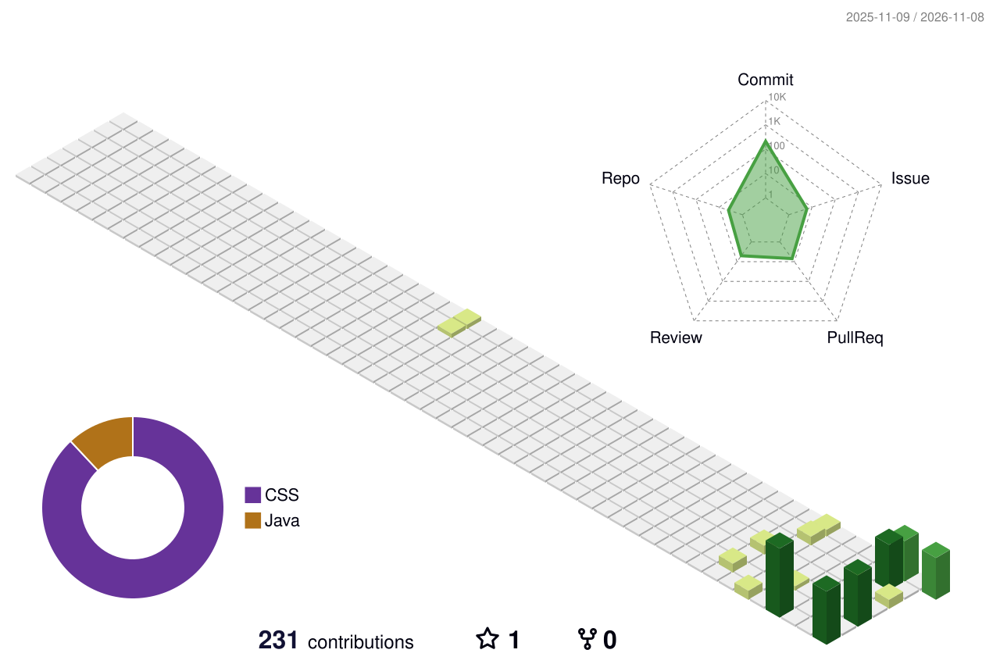
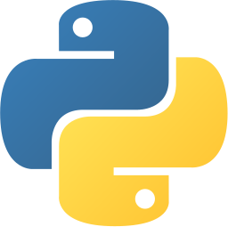

 

[Portfólio](https://andre-graccia-curriculum.vercel.app) &nbsp;·&nbsp;
[LinkedIn](https://www.linkedin.com/in/andregraccia/) &nbsp;·&nbsp;
[E-mail](mailto:andregraccia2105@gmail.com)

 

<picture>
  <source media="(prefers-color-scheme: dark)" srcset="./profile-3d-contrib/profile-night-rainbow.svg">
  
</picture>

## Sobre

Engenheiro de Software e estudante de **Ciência da Computação**. Construo **APIs em Java com Spring Boot**, automatizo testes em **Python** e estudo **agentes de IA**. Hoje atuo na **Cielo**, em automação e qualidade de software.

Gosto de backend: a parte que ninguém vê e da qual tudo depende.

## Projetos

<table>
<tr>
<td width="50%" valign="top">

### [Calculadora de Juros](https://github.com/AndreGraccia/calc-juros)

API em Java 25 e Spring Boot que calcula juros simples e compostos com `BigDecimal`. Indicadores do Banco Central estão no roadmap.

`Java` `Spring Boot` `Maven`

</td>
<td width="50%" valign="top">

### [wall.ia](https://github.com/AndreGraccia/wall.ia)

Gestão financeira full-stack com Spring Security e JWT.

`React` `Spring Boot` `PostgreSQL` `Docker`

### [Orbit.IA](https://github.com/AndreGraccia/Orbit.IA)

Orquestrador de agentes de IA com React, n8n e LangChain, integrado a Google Workspace e GitHub.

`React` `n8n` `LangChain`

</td>
</tr>
</table>

## Stack

&nbsp;&nbsp;&nbsp;&nbsp;&nbsp;&nbsp;&nbsp;&nbsp;&nbsp;&nbsp;&nbsp;&nbsp;&nbsp;&nbsp;&nbsp;&nbsp;&nbsp;&nbsp;

## Atividade

 

## Contato

[LinkedIn](https://www.linkedin.com/in/andregraccia/) · [andregraccia2105@gmail.com](mailto:andregraccia2105@gmail.com) · São Paulo, Brasil

Skyline e gráficos de atividade são gerados por GitHub Actions todo dia. As saídas dos comandos no terminal são ilustrativas.
