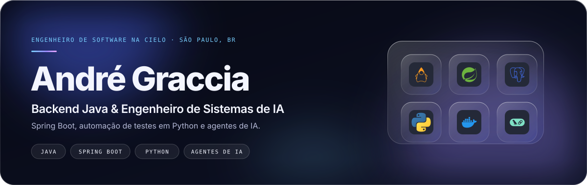
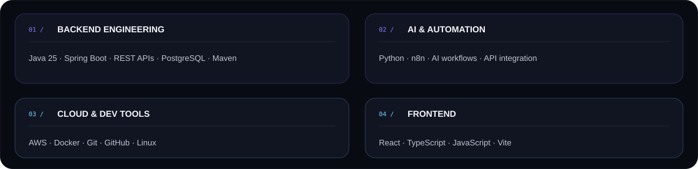

  <a href="mailto:andregraccia2105@gmail.com">Email</a> ·
  <a href="https://br.linkedin.com/in/andregraccia">LinkedIn</a> ·
  <a href="https://andre-graccia-curriculum-andre-de9d.vercel.app">Portfólio</a> ·
  <a href="https://github.com/AndreGraccia/AndreGraccia/blob/main/Curriculo_Andre_Graccia.pdf">Currículo</a>

---

## Sobre

Sou estudante de **Ciência da Computação na Universidade Anhembi Morumbi** e profissional da **Cielo**. Tenho foco em desenvolvimento backend com Java, construção de APIs e integração entre sistemas.

Também exploro **IA aplicada**, automação de processos e infraestrutura em nuvem. Gosto de entender o problema, estruturar bem a solução e construir software que seja legível, testável e sustentável.

## Áreas de engenharia

| Backend Engineering | AI Engineering | Cloud Engineering |
|:--|:--|:--|
| Java · Spring Boot | Python · n8n | AWS · Docker |
| REST APIs · PostgreSQL | AI workflows · APIs | Git · CI/CD |
| Maven · Modelagem | Automação · Integrações | Deploy · Infraestrutura |

## Stack

  

## Projetos selecionados

  

- **[Wall.ia](https://github.com/AndreGraccia/Wall.ia)** — carteira digital para organização de compromissos financeiros. Projeto de estudo; não movimenta dinheiro real.
- **[Calculadora de Juros](https://github.com/AndreGraccia/calc-juros)** — API para simulações de juros simples e compostos.
- **[Orbit.ia](https://github.com/AndreGraccia/Orbit.ia)** — agente pessoal com interface própria e automações orquestradas pelo n8n.

## Atividade no GitHub

  

As métricas são geradas pelo GitHub Actions. Commits, pull requests, issues e repositórios contribuídos refletem os últimos 12 meses; stars somam os repositórios públicos próprios.

## Formação & certificações

- **Ciência da Computação** — Universidade Anhembi Morumbi (2025–2028)
- **Oracle Cloud Infrastructure 2025 Certified Foundations Associate**
- **Google — Inteligência Artificial e Produtividade**
- **SENAI — Lógica de Programação**
- **English: B1**

---

**Interessado em construir software útil, confiável e bem projetado.**

<a href="mailto:andregraccia2105@gmail.com">Entre em contato</a> ·
<a href="https://br.linkedin.com/in/andregraccia">LinkedIn</a> ·
<a href="https://andre-graccia-curriculum-andre-de9d.vercel.app">Portfólio</a>

ANDRÉ GRACCIA · BACKEND / AI / CLOUD ENGINEERING · SÃO PAULO, BRASIL

