<div align="center">


<br/>

[**Portfólio**](https://andre-graccia-curriculum.vercel.app) &nbsp;·&nbsp;
[**LinkedIn**](https://www.linkedin.com/in/andregraccia/) &nbsp;·&nbsp;
[**E-mail**](mailto:andregraccia2105@gmail.com) &nbsp;·&nbsp;
[**Currículo (PDF)**](Curriculo_Andre_Graccia.pdf)

</div>

<br/>

## Sobre

Estudante de **Ciência da Computação** (Universidade Anhembi Morumbi) e **Engenheiro de Software (Aprendiz) na Cielo** desde julho de 2026.

Foco em **backend Java com Spring Boot**, **automação de testes em Python** e **arquitetura de agentes de IA**. Experiência com APIs RESTful, bancos relacionais, Docker, suítes de testes automatizados, otimização de consultas SQL e orquestração de workflows de IA.

## Stack

<table align="center">
<tr>
<td align="center" width="33%"><sub><b>LINGUAGENS</b></sub><br/><br/>


</td>
<td align="center" width="33%"><sub><b>BACKEND</b></sub><br/><br/>


</td>
<td align="center" width="33%"><sub><b>AGENTES DE IA</b></sub><br/><br/>


</td>
</tr>
<tr>
<td align="center"><sub><b>BANCOS DE DADOS</b></sub><br/><br/>


</td>
<td align="center" colspan="2"><sub><b>DEVOPS & QUALIDADE</b></sub><br/><br/>


</td>
</tr>
</table>

<sub>Também: SQL Server · DB2 · Microservices · TDD · Clean Architecture · Scrum · Kanban.</sub>

## Experiência

**Cielo — Engenheiro de Software (Aprendiz)** · Barueri, SP · jul/2026 – presente

- Automação de testes funcionais e regressivos em **Python**, reduzindo o tempo de validação.
- Diagnósticos automatizados em ambiente de testes para identificar gargalos e garantir confiabilidade.
- Otimização de consultas e validações em **SQL Server** e **DB2**, com consistência transacional.
- **IA generativa** para triagem de logs, diagnóstico de falhas e geração de cenários de teste.

## Projetos


| Projeto | O que faz | Stack |
|:--|:--|:--|
| **Conciliador** | API de conciliação: cruza vendas e extrato e aponta divergências com o motivo (ex.: taxa acima do contrato). | Java 21 · Spring Boot · PostgreSQL |
| [**Orbit.IA**](https://github.com/AndreGraccia/Orbit.IA) | Orquestrador de agentes de IA que delega tarefas a sub-agentes especialistas e integra Google Workspace e GitHub. | React · Vite · n8n · LangChain · OpenRouter |
| [**wall.ia**](https://github.com/AndreGraccia/wall.ia) | Gestão financeira full-stack: backend escalável, autenticação com JWT e banco isolado em Docker. | Java 17 · Spring Boot · Spring Security · PostgreSQL · Docker |
| **Calculadora de Juros** | Serviço Java integrado às APIs REST do Banco Central (Selic, IPCA, CDI em tempo real). | Java · Spring Boot · Maven |

## Atividade



<sub>Gerado diariamente por GitHub Actions a partir de dados públicos do perfil.</sub>

## Formação e certificações

- **Bacharelado em Ciência da Computação** — Universidade Anhembi Morumbi · fev/2025 – dez/2028 (previsão)
- **Inteligência Artificial e Produtividade** — Google / Santander · 2026
- **Lógica de Programação e Estruturas de Dados** — SENAI · 2025
- **Oracle Cloud Infrastructure Foundations** — Oracle Academy · 2025
- **Idiomas:** Português (nativo) · Inglês B1 (leitura técnica, documentação e comunicação profissional)

## Estrutura do repositório

```text
index.html · styles.css · app.js   site do portfólio (Vercel)
resume/curriculo.html              fonte do currículo ATS → Curriculo_Andre_Graccia.pdf
assets/                            imagens do README, ícones, og.png e brand/ (artes da marca)
scripts/                           geradores de SVG e ícones
.github/workflows/profile.yml      atualização diária das estatísticas e SVGs
```

<div align="center">

<br/>

**Backend é a parte que ninguém vê. É a que eu mais gosto de construir.**

[Entre em contato](mailto:andregraccia2105@gmail.com) &nbsp;·&nbsp; [Portfólio](https://andre-graccia-curriculum.vercel.app) &nbsp;·&nbsp; [LinkedIn](https://www.linkedin.com/in/andregraccia/)

</div>
