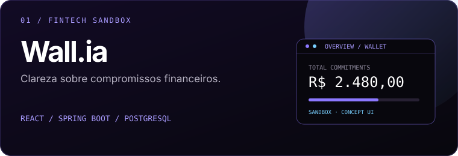
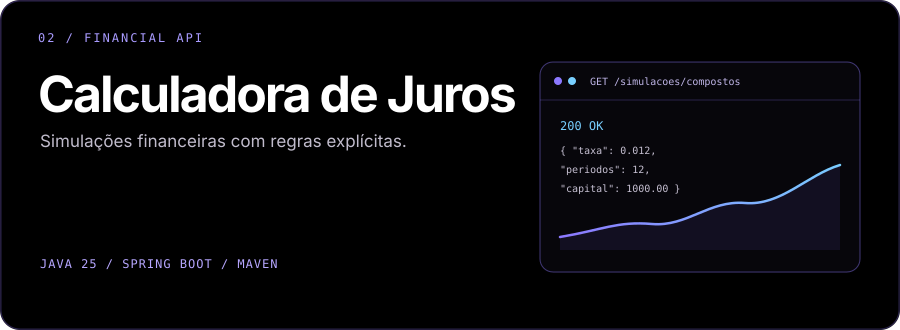
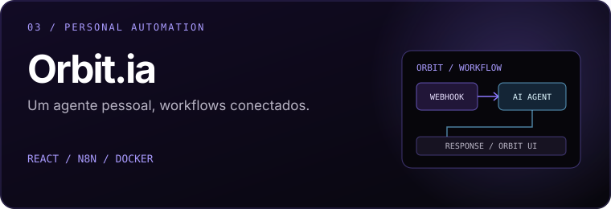

  
  

    <a href="mailto:andregraccia2105@gmail.com">✉ EMAIL</a> &nbsp;·&nbsp;
    <a href="https://br.linkedin.com/in/andregraccia">↗ LINKEDIN</a> &nbsp;·&nbsp;
    <a href="https://andre-graccia-curriculum-andre-de9d.vercel.app">⌘ PORTFÓLIO</a> &nbsp;·&nbsp;
    <a href="https://github.com/AndreGraccia/AndreGraccia/blob/main/Curriculo_Andre_Graccia.pdf">↓ CURRÍCULO PDF</a>
  

---

<table>
<tr>
<td width="62%" valign="top">
01 / PROFILE
<h2>Construindo software confiável para problemas reais.</h2>
Estudante de Ciência da Computação na Universidade Anhembi Morumbi e profissional da Cielo. Meu foco é desenvolvimento backend com Java, APIs e integração entre sistemas.
  
Interesso-me por regras de negócio, modelagem de domínio, persistência de dados e arquitetura de aplicações. Valorizo código legível, responsabilidades bem definidas e soluções que possam evoluir.
</td>
<td width="38%" valign="top">
FOCO PROFISSIONAL
<h3>Backend Engineering</h3>

Java · Spring Boot REST APIs · PostgreSQL Integração de sistemas Automação & infraestrutura

LOCALIZAÇÃO

São Paulo, Brasil

</td>
</tr>
</table>

## 02 / TECHNOLOGY

CORE STACK — tecnologias que direcionam meus estudos e projetos

TOOLS & EXPLORATION

---

## 03 / SELECTED WORK

**Wall.ia** · Fintech / Open Finance sandbox

Uma carteira digital para organizar compromissos financeiros e tornar a origem dos valores mais clara. Projeto de estudo; não movimenta dinheiro real.

REACT · SPRING BOOT · POSTGRESQL · [REPOSITÓRIO ↗](https://github.com/AndreGraccia/Wall.ia)

 

**Calculadora de Juros** · Financial API

API para simulações de juros simples e compostos, com foco em regras de cálculo e organização da aplicação.

JAVA 25 · SPRING BOOT · MAVEN · [REPOSITÓRIO ↗](https://github.com/AndreGraccia/calc-juros)

 

**Orbit.ia** · Personal AI / Automation

Agente pessoal com interface própria e workflows orquestrados pelo n8n. Projeto voltado à integração entre interface, automação e serviços locais.

REACT · N8N · DOCKER · [REPOSITÓRIO ↗](https://github.com/AndreGraccia/Orbit.ia)

---

  

---

<h3>Vamos construir algo consistente.</h3>
<a href="https://br.linkedin.com/in/andregraccia">LINKEDIN</a> &nbsp;·&nbsp;
<a href="mailto:andregraccia2105@gmail.com">EMAIL</a> &nbsp;·&nbsp;
<a href="https://andre-graccia-curriculum-andre-de9d.vercel.app">PORTFÓLIO</a>
  
ANDRÉ GRACCIA / BACKEND JAVA / SÃO PAULO, BRASIL

