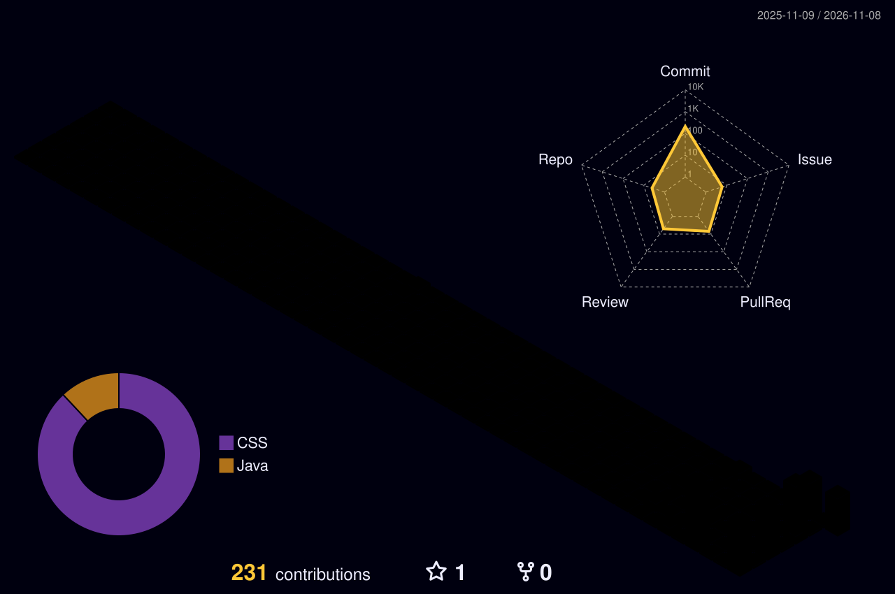

# André Graccia

**Engenheiro de Software · Backend Java · Python · Agentes de IA**

[Portfólio](https://andre-graccia-curriculum.vercel.app) &nbsp;·&nbsp;
[LinkedIn](https://www.linkedin.com/in/andregraccia/) &nbsp;·&nbsp;
[E-mail](mailto:andregraccia2105@gmail.com)

## Sobre

Engenheiro de Software e estudante de **Ciência da Computação**. Construo **APIs em Java com Spring Boot**, automatizo testes em **Python** e estudo **agentes de IA**. Hoje atuo na **Cielo**, em automação e qualidade de software.

Gosto de backend: a parte que ninguém vê e da qual tudo depende.

## Projetos

- **Conciliador** — API que cruza vendas e extrato e aponta divergências com o motivo. `Java 21` `Spring Boot` `PostgreSQL`
- [**Orbit.IA**](https://github.com/AndreGraccia/Orbit.IA) — orquestrador de agentes de IA integrado a Google Workspace e GitHub. `React` `n8n` `LangChain`
- [**wall.ia**](https://github.com/AndreGraccia/wall.ia) — gestão financeira full-stack com autenticação JWT. `Java 17` `Spring Security` `Docker`
- **Calculadora de Juros** — serviço Java sobre as APIs do Banco Central. `Java` `Spring Boot`

## Atividade

 

## Stack

&nbsp;&nbsp;&nbsp;&nbsp;&nbsp;&nbsp;&nbsp;&nbsp;&nbsp;&nbsp;&nbsp;&nbsp;&nbsp;&nbsp;&nbsp;&nbsp;&nbsp;&nbsp;&nbsp;&nbsp;

## Contato

[LinkedIn](https://www.linkedin.com/in/andregraccia/) · [andregraccia2105@gmail.com](mailto:andregraccia2105@gmail.com) · São Paulo, Brasil
