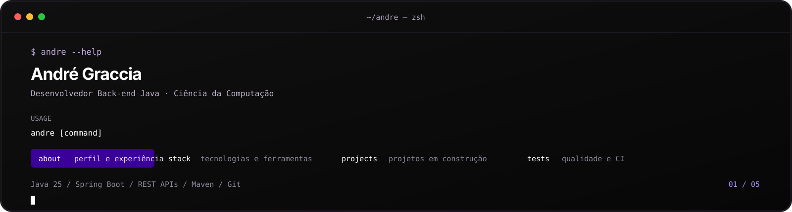
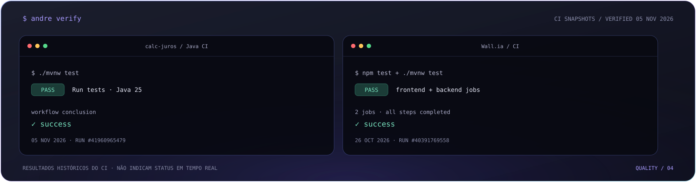
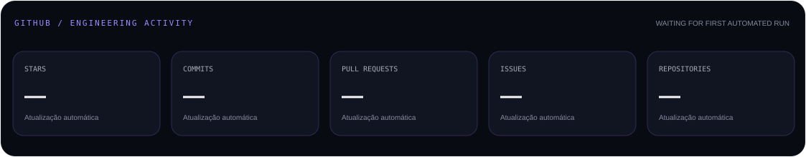

<div align="center">
  
</div>

<div align="center">
  <a href="https://br.linkedin.com/in/andregraccia"></a>
  <a href="mailto:andregraccia2105@gmail.com"></a>
  <a href="./Curriculo_Andre_Graccia.pdf"></a>
</div>

<br />

<div align="center">
  
</div>

## 01 / Sobre

Sou estudante de **Ciência da Computação** na Universidade Anhembi Morumbi e atuo profissionalmente na **Cielo**. Meu foco de desenvolvimento está em engenharia de software, especialmente backend com Java, APIs e integração entre sistemas.

Gosto de transformar requisitos em soluções claras: entender o domínio, separar responsabilidades, validar regras e deixar decisões técnicas fáceis de manter. Nos projetos, busco combinar implementação, testes, documentação e evolução incremental.

## 02 / Stack

<div align="center">
  
  <br />
  
  &nbsp;
  
  &nbsp;
  
  &nbsp;
  
</div>

<div align="center">
  
</div>

## 03 / Projetos em destaque

| Projeto | O que estou construindo | Stack principal | Status |
| :--- | :--- | :--- | :--- |
| [**Wall.ia**](https://github.com/AndreGraccia/Wall.ia) | Carteira digital que projeta compromissos financeiros e explica a origem dos valores. Open Finance em sandbox; não movimenta dinheiro real. | React · Spring Boot · PostgreSQL | Em desenvolvimento |
| [**Calculadora de Juros**](https://github.com/AndreGraccia/calc-juros) | API para simulações de juros simples e compostos. Integração com séries e indicadores do Banco Central está no roadmap. | Java 25 · Spring Boot · Maven | Em desenvolvimento |
| [**Orbit.ia**](https://github.com/AndreGraccia/Orbit.ia) | Agente pessoal com interface React/Vite e workflows orquestrados pelo n8n. Integrações externas exigem configuração e validação no ambiente. | React · n8n · Docker · PostgreSQL | Em evolução |

## 04 / Developer workflow

Uma das formas de reproduzir a verificação da **Calculadora de Juros** é usar o Maven Wrapper:

```bash
git clone https://github.com/AndreGraccia/calc-juros.git
cd calc-juros
./mvnw test
```

No Windows:

```powershell
.\mvnw.cmd test
```

<div align="center">
  
</div>

Os resultados ilustrados são execuções reais consultadas no GitHub Actions: **05/11/2026** para a Calculadora de Juros e **26/10/2026** para Wall.ia. São registros históricos, não indicadores de execução em tempo real.

<div align="center">

[CI — Calculadora de Juros](https://github.com/AndreGraccia/calc-juros/actions/runs/41960965479) &nbsp;·&nbsp; [CI — Wall.ia](https://github.com/AndreGraccia/Wall.ia/actions/runs/40391769558)

</div>

## 05 / GitHub activity

<div align="center">
  
</div>

<div align="center">
  
</div>

### Contribution skyline

<div align="center">
  
</div>

<div align="center">

[Repositórios](https://github.com/AndreGraccia?tab=repositories) &nbsp;·&nbsp; [Atividade](https://github.com/AndreGraccia?tab=overview) &nbsp;·&nbsp; [GitHub Actions](https://github.com/AndreGraccia/AndreGraccia/actions)

</div>

## 06 / Let's connect

Aberto a conversas sobre backend, engenharia de software, colaboração em projetos e oportunidades profissionais.

<div align="center">
  <a href="https://br.linkedin.com/in/andregraccia"></a>
  <a href="mailto:andregraccia2105@gmail.com"></a>
</div>
