🇧🇷 **Português** &nbsp;·&nbsp; [🇺🇸 English](./README.en.md)

 

&nbsp;
&nbsp;
&nbsp;

## Sobre

Engenheiro de software Java em formação (full stack) e estudante de **Ciência da Computação**. Construo **APIs em Java com Spring Boot**, **interfaces responsivas em React** e automatizo testes em **Python**. Hoje sou aprendiz de Engenharia de Software na **Cielo**, em automação e qualidade de software.

Na Calculadora de Juros uso `BigDecimal` em vez de `double` e decido onde arredondar: só no resultado final, com 2 casas (HALF_UP). Penso o sistema inteiro: como o back e o front se conectam, como a tela se adapta ao celular e o que acontece quando algo falha. Uso IA como engenheiro, não como atalho: defino a estrutura e as regras, depois reviso e testo o que ela escreve.

Estou em formação e evoluo a cada projeto, hoje também na prática, na Cielo. Aprendo construindo, errando, corrigindo e medindo.

## Projetos

<table>
<tr>
<td width="38%" valign="middle">

### [Calculadora de Juros](https://github.com/AndreGraccia/calc-juros)

API em Java 25 e Spring Boot que calcula juros simples e compostos com `BigDecimal`. Indicadores do Banco Central estão no roadmap.

`Java` `Spring Boot` `Maven`

</td>
<td width="62%"></td>
</tr>
<tr>
<td valign="middle">

### [wall.ia](https://github.com/AndreGraccia/wall.ia)

Gestão financeira full-stack com Spring Security e JWT.

`React` `Spring Boot` `PostgreSQL` `Docker`

</td>
<td></td>
</tr>
<tr>
<td valign="middle">

### [Orbit.IA](https://github.com/AndreGraccia/Orbit.IA)

Agente pessoal com interface React e orquestração pelo n8n, integrado a Google Workspace e GitHub.

`React` `n8n` `LangChain` `Docker`

</td>
<td></td>
</tr>
</table>

## Stack

&nbsp;&nbsp;&nbsp;&nbsp;&nbsp;&nbsp;&nbsp;&nbsp;&nbsp;&nbsp;&nbsp;&nbsp;&nbsp;&nbsp;&nbsp;&nbsp;&nbsp;&nbsp;

## Atividade

 

 

## Contato

[LinkedIn](https://www.linkedin.com/in/andregraccia/) · [andregraccia2105@gmail.com](mailto:andregraccia2105@gmail.com) · São Paulo, Brasil

Skyline e gráficos de atividade são gerados por GitHub Actions todo dia. As saídas dos comandos no terminal são ilustrativas.
