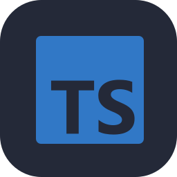

<div align="center">


<br/>

[**Portfólio**](https://andre-graccia-curriculum.vercel.app) &nbsp;·&nbsp;
[**LinkedIn**](https://br.linkedin.com/in/andregraccia) &nbsp;·&nbsp;
[**E-mail**](mailto:andregraccia2105@gmail.com) &nbsp;·&nbsp;
[**Currículo (PDF)**](Curriculo_Andre_Graccia.pdf)

</div>

<br/>

## Sobre

Estudante de **Ciência da Computação na Universidade Anhembi Morumbi** e profissional na **Cielo**, com foco em backend e engenharia de software.

Transformo requisitos em software sustentável: entendo o problema, modelo o domínio, construo APIs, integro serviços e evoluo a solução por iteração. Hoje estudo e desenvolvo projetos com **Java, Spring Boot, bancos relacionais, automação e IA aplicada**.

## Stack

<table align="center">
<tr>
<td align="center" width="33%"><sub><b>BACKEND & DADOS</b></sub><br/><br/>


</td>
<td align="center" width="33%"><sub><b>WEB & LINGUAGENS</b></sub><br/><br/>




</td>
<td align="center" width="33%"><sub><b>IA & AUTOMAÇÃO</b></sub><br/><br/>


</td>
</tr>
<tr>
<td align="center" colspan="3"><sub><b>ENTREGA & CLOUD</b></sub><br/><br/>


</td>
</tr>
</table>

## Projetos


| Projeto | O que é | Stack |
|:--|:--|:--|
| [**Calculadora de Juros**](https://github.com/AndreGraccia/calc-juros) | API para simulação de juros simples e compostos, com regras de domínio e cálculos financeiros. | Java 25 · Spring Boot · Maven |
| [**Wall.ia**](https://github.com/AndreGraccia/Wall.ia) | Conceito de carteira digital para organizar compromissos financeiros. Projeto de portfólio; não executa transações reais. | React · Spring Boot · PostgreSQL |
| [**Orbit.ia**](https://github.com/AndreGraccia/Orbit.ia) | Agente pessoal com interface própria e workflows n8n. | React · n8n · Docker |

Mais experimentos na aba de [repositórios](https://github.com/AndreGraccia?tab=repositories).

## Atividade


<sub>Métricas e skyline são atualizados diariamente por GitHub Actions (últimos 12 meses).</sub>

## Formação

- **Ciência da Computação** — Universidade Anhembi Morumbi · em andamento
- **Oracle Cloud Infrastructure 2025 Certified Foundations Associate**
- **Google** — Inteligência Artificial e Produtividade
- **SENAI** — Lógica de Programação
- **Idiomas:** Português (nativo) · Inglês (B1)

## Estrutura do repositório

```text
index.html · styles.css · app.js   site do portfólio (Vercel)
assets/                            imagens do README e dos ícones (geradas por scripts/)
scripts/                           geradores de SVG e ícones
.github/workflows/profile.yml      atualização diária dos assets
```

<div align="center">

<br/>

**Interessado em construir software útil, confiável e bem projetado.**

[Entre em contato](mailto:andregraccia2105@gmail.com) &nbsp;·&nbsp; [Portfólio](https://andre-graccia-curriculum.vercel.app) &nbsp;·&nbsp; [LinkedIn](https://br.linkedin.com/in/andregraccia)

</div>
